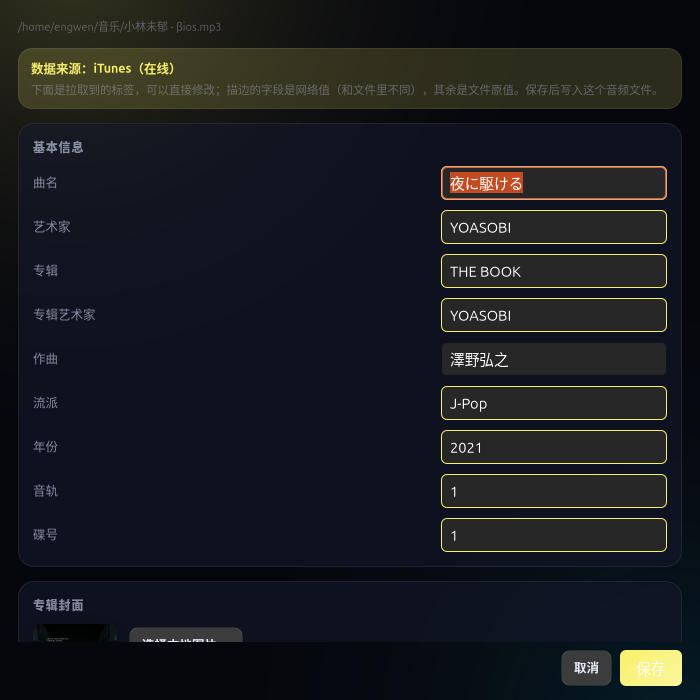

# OwlMusic

一个用 **Rust + GTK4** 写的本地音乐播放器：顶部标题栏、左侧歌单、右侧整栏同步歌词、底部常驻播放条。
视觉基调参考了 mhertz 那套「深墨紫底 + 浮起卡片 + 紫青渐变」——窗口不是一整块纯色，
而是深色底 + 两团很淡的紫/冷青柔光，侧栏和播放条各自是一张 20px 圆角的半透明卡片，
强调色只出现在「正在播放、进度、主按钮」这些当前状态上。不联网也能用，联网只是用来补标签和歌词。

```
┌──────────────────────────────────────────────────────────┐
│  ♪ owlmusic                          ＋ ↻ ⚙      — □ ×   │  ← 固定 54px
├──────────────────┬───────────────────────────────────────┤
│  歌单（可搜索）   │                                       │
│  ┌────────────┐  │   歌词（整栏，上顶顶栏下顶播放条）      │  ← 弹性
│  │ 01 曲名     │  │   背景 = 毛玻璃化的专辑封面            │
│  └────────────┘  │   当前行高亮、逐字填充、平滑滚动         │
├──────────────────┴───────────────────────────────────────┤
│  ⏮  ▶  ⏭   0:42 ──────●──────── 3:58   🔊 ────  ⤢        │  ← 固定 76px
└──────────────────────────────────────────────────────────┘
```

两栏中间是一条可拖动的分隔条：宽度随拖随记（`config.sidebar_w`），切歌、换主题都不会重置，
窗口变宽时余量只给歌词那一侧。

顶栏和播放条是**外壳**，高度写死（`ui::HEADER_H` / `ui::BAR_H`），只有中间的歌单和歌词区随窗口伸缩。
封面用的是按显示尺寸生成的缩略纹理（`art::square`）——`gtk::Picture` 的布局尺寸跟着纹理走，
直接塞原图会让一张 1000px 的封面把播放条顶高。

## 功能

**播放**
- 格式（能解码 + 能读标签）：**MP3 · FLAC · M4A/MP4（AAC / ALAC）· AAC · OGG Vorbis · WAV · AIFF · CAF · MKA**
- 只进曲库、能改标签但解不了码的：**Opus · APE · WavPack · DSD(dsf) · WMA**
  （Opus 是因为 symphonia 0.5 只带 Vorbis 解码器；点播放会明确提示，
  用 `owlmusic --probe 文件` 可以看到具体是「容器认不出」还是「编码不支持」）
- 递归扫描目录、搜索过滤、双击播放、上一首/下一首、进度拖拽、音量
- 列表只有一个视觉状态：正在播放（行内浅底色 + 曲名强调色，不加边框/竖线）。
  GTK 自带的选中/焦点框全部关掉——否则切歌后旧行还挂着选中色，像"两个正在播放"
- 三种模式：列表循环 / 单曲循环 / 关闭循环，另有随机播放
- **MPRIS（`org.mpris.MediaPlayer2.owlmusic`）**：GNOME 的媒体控制中心、Media Controls /
  Top Bar Lyrics 这类插件能读到歌名、艺人、专辑、封面、进度，也能反过来播/暂/上一首/下一首/拖进度。
  直接用 GDBus 注册，不引 zbus/tokio
- 退出时记住窗口尺寸、音量、上次播放的曲目与进度，下次打开可以接着听

**歌词**
- 查找顺序固定四级：**音频内嵌歌词标签 → 设置里的歌词文件夹 → 音频同目录的 `.lrc` → 上次在线缓存 → 在线（LRCLIB）**
- **歌词文件夹**（设置 → 歌词）：选一个目录专门放 `.lrc`，集中管理、不污染音乐目录。
  认「歌手 - 曲名」「曲名」「01 曲名」这几种命名，大小写和空格差异都能匹配
- 同一处还有「如无歌词，自动下载到此文件夹」：**选定目录后默认勾上，之后随时可以关掉**（这个开关
  不受有没有选目录限制）。勾上时在线匹配到的歌词会存成 `歌手 - 曲名.lrc` 放进该目录，下次播这首
  （甚至换台机器带着歌词文件夹）就能直接读到；不勾就只在内存里显示，磁盘上只留程序自己的缓存
  （`~/.cache/owlmusic/lyrics/`），不往你的目录里塞文件
- 手动点搜索按钮（歌词栏右侧）会先把**所有候选列出来**：每条显示艺人 / 专辑 / 时长 / 行数，并标出
  「逐行」还是「纯文本」；选中就能在下面预览歌词开头，觉得对了再点「使用这份歌词」（双击直接应用）。
  列表按「有时间轴优先、时长最接近本曲优先」排序，时长差太多会直接提示可能对不上。
  换关键词可以在同一个窗口里重搜。应用后落盘规则同上：设了歌词文件夹就存那儿，没设就跟音频放一起
- 同一处还有「**选择歌词后自动写入源文件**」，**默认开、随时能关**。开着时在候选窗口点「使用这份歌词」，
  除了落一个 `.lrc`，还会把这份歌词写进当前这首歌自己的标签（ID3 的 `USLT`、Vorbis 的 `LYRICS`、
  MP4 的 `©lyr`、APE 的 `Lyrics`）——换播放器、拷到别的机器上都还带着歌词。只写当前这一首，不批量改；
  关掉就只在程序里显示，不碰音频文件。格式没有歌词字段或文件只读时，状态栏会说明，不影响播放
- 正在唱的那句**始终停在歌词控件的中线**：位置由 `compute_bounds` 实测，不是按行高估算累加；
  首尾各留半个视口，第一行和最后一行也能居中
- 起播/暂停有 320ms 淡入淡出（按每块的真实时长做块内插值），不会一下子满音量出声
- 解析标准 LRC：多时间标签、`[offset:]`、逐字标签（`<mm:ss.xx>`）、原文/翻译双行合并
- **卡拉OK式填充**：当前行按进度逐字点亮（有逐字标签就按标签走，没有就按该行时长线性推进，
  偏移一定落在 UTF-8 字符边界上），已唱的行比没唱的更亮
- 切行时整块歌词连续上移（每帧追一截），不是攒够一行猛跳一格
- 手动滚动（拖滚动条 / 滚轮 / **直接在歌词上按住拖**）时不抢位置：滚多久都不回弹，松手 3 秒后才回到当前行；
  直接按住歌词拖和拖滚动条是同一套手感，内容跟着指针连续移动，不会在松手时「闪」到别处
- 轻点任意一行跳到对应位置（按真实布局位置判断点到哪一行，不按行高估算）
- 样式可调：字号、颜色（跟随主题或强调色）、对齐、行距、上下偏移、非当前行透明度、是否显示翻译

**标签（重点）**
- 读取：曲名、艺术家、专辑、专辑艺术家、作曲、年份、音轨/碟号、流派、内嵌封面、内嵌歌词
- **第一步就分派到标签方言**（`src/meta/`）：先判断文件用的是哪种标签
  （ID3v2.2 / 2.3 / 2.4、ID3v1、VorbisComment、MP4 ilst、APEv2、RIFF INFO），
  再由该方言给出**每个字段**的记号。不是「读年份时特判一套、读作曲时再猜一套」：

  | 字段 | v2.2 | v2.3 | v2.4 | Vorbis | MP4 | APEv2 |
  |---|---|---|---|---|---|---|
  | 曲名 | TT2 | TIT2 | TIT2 | TITLE | ©nam | Title |
  | 艺术家 | TP1 | TPE1 | TPE1 | ARTIST | ©ART | Artist |
  | 专辑 | TAL | TALB | TALB | ALBUM | ©alb | Album |
  | 作曲 | TCM | TCOM | TCOM | COMPOSER | ©wrt | Composer |
  | 年份 | TYE | TYER | TDRC | DATE / YEAR | ©day | Year / Date |
  | 音轨 | TRK | TRCK | TRCK | TRACKNUMBER | trkn | Track |
  | 歌词 | ULT | USLT | USLT | LYRICS | ©lyr | Lyrics |
  | 封面 | PIC | APIC | APIC | 图片块 | covr | Cover Art |

- 读不到才回原始字节：`TXXX:YEAR` 这类私货、v2.2 的 3 字节帧头、甚至 lofty
  整个解析失败的怪文件，都由 ID3v2 方言自己按帧扫描（支持去同步、扩展头、
  编码 0/1/2/3），主标签缺的字段再落到副标签（老 MP3 常见：v2 没年份、v1 才有）
- **写入是单一入口、统一升级**：`meta::write_meta` 是所有字段修改的唯一公共入口。
  只要改任意一个字段（曲名、年份、歌词、在线匹配整批写入……），ID3 家族都会把
  整张标签**重建为 ID3v2.4**：
  - v2.2 的三字节帧 ID 全部换成 v2.4 的四字节写法，`PIC` 转 `APIC`，
    `TORY` 转 `TDOR`，`IPLS` 转 `TIPL`；v2.4 已废弃的 `TSIZ`/`RVAD`/`EQUA` 丢弃
  - 各版本的年份写法（`TYE` / `TYER`+`TDAT`+`TIME` / `TDRC` / `TXXX:YEAR`）
    合并成一条 `TDRC`，原 `TDRC` 带月日时保留完整日期
  - 文件尾的 ID3v1 先把独有字段并入 v2.4，然后删除，只留一张标签
  - 其余不相关帧原样保留（只换帧头），音轨号 `3/10` 里的总数不会丢
- 其它容器用它自己的标准标签（FLAC/OGG → VorbisComment、M4A → ilst、APE → APEv2），
  因为这些格式存不了 ID3v2.4
- 写完统一读回校验；报告里会说明「从 v2.3 升级到 v2.4」「移除了 ID3v1」这类动作，
  存不下的字段（如 ID3v1 存不了中文）也会明确列出，而不是写一堆乱码还报成功
- 右键菜单 →「在线匹配元数据…」：iTunes Search + MusicBrainz 双源检索，先预览候选（封面、专辑、年份）
- **在线数据也进编辑页**：选中一条结果点「编辑并保存…」（双击结果行同样可以），会带着网络数据打开和手动编辑
  **同一个页面**——字段全部展示出来（曲名/艺术家/专辑/专辑艺术家/作曲/流派/年份/音轨/碟号），可直接改；
  网络没给的字段回落到文件原值，不覆盖。描边的输入框表示这一项和文件里的不同（网络来的）。
  保存走和手动编辑完全相同的写入路径（统一升级 ID3v2.4），默认就把改动写回源文件
  
- 右键菜单 →「编辑标签…」：手动改曲名/艺术家/专辑/专辑艺术家/作曲/流派/年份/音轨/碟号，替换或删除封面，直接粘贴 LRC 歌词；保存时只提交真正改过的字段
- **写入策略**：手动编辑时「同时写入音频文件」默认关闭 —— 关闭时只改当前运行中的显示，一个字节都不碰文件；打开才写回。
  从在线匹配进来时该开关默认打开（那一刻的意图就是更新这个文件）
- 写回失败（只读文件、权限不足）只会提示，不会崩

**界面**
- 顶栏按钮：添加文件夹、重新扫描、设置；系统自带的最小化/最大化/关闭
- 设置里可以：切深色/浅色、强调色（可跟随封面主色）、歌单放左侧或右侧、歌词背景用不用封面、背景模糊强度、**背景不透明度**、无歌词时是否自动在线匹配、**歌词文件夹与「找不到就下到那儿」**、**选中歌词后是否写进音频文件的歌词标签**
- 右键菜单还支持「在文件夹中显示」「从列表移除」（移除只是移出列表，文件不动）

## 编译

需要 Rust 1.75+，以及 GTK4 的开发文件：

```bash
sudo apt install build-essential pkg-config libgtk-4-dev libasound2-dev
cargo build --release
```

产物在 `target/release/owlmusic`。

> 如果系统里只装了 GTK4 的运行时（没有 `libgtk-4-dev`），`pkg-config` 会找不到 `gdk4.pc / gsk4.pc`。
> 项目里带了一个 `.devdeps/` 兼容层，可以直接：
> ```bash
> PKG_CONFIG_PATH="$PWD/.devdeps/pc" cargo build --release
> ```
> 它只是补两份 pkg-config 描述，指向系统已有的 `libgtk-4.so`，对产物没有影响。

## 运行

```bash
./target/release/owlmusic
```

首次打开点右上角文件夹图标选一个音乐目录，会递归扫描。配置写在 `~/.config/owlmusic/config.json`，封面/歌词缓存在 `~/.cache/owlmusic/`（都遵循 `XDG_CONFIG_HOME` / `XDG_CACHE_HOME`）。

**Dock / 任务栏上显示的名字**：窗口的 app_id 是 `io.github.owl.owlmusic`，X11 的 `WM_CLASS` 和 desktop 里的
`StartupWMClass` 都对齐成同一个值。没装 deb（直接跑 `./target/release/owlmusic`）时，系统里没有 `.desktop`，
Dock 只能拿 app_id 当名字，于是显示成一串带点的标识；所以首次启动会往 `~/.local/share/applications/`
补一份条目（带 `X-OwlMusic-Auto=true` 标记，`Exec` 指向当前二进制），图标也一并写到用户图标目录。
装了 deb 之后这份自动条目会被自动删掉，改用 `/usr/share/applications` 里那份，免得旧路径遮住系统版本。

**出问题先看 `~/.cache/owlmusic/run.log`**：release 是 `panic = "abort"`，程序崩掉是「一声不响地消失」，
所以启动/激活/扫描/退出各记一行，panic 会连回溯一起写进去。如果上次是刚启动就没的，
本次会自动进**安全模式**（临时关掉封面背景与跟随封面），窗口至少能起来，状态栏会写明。

快捷键：`空格` 播放/暂停，`← →` 前后 5 秒。右键歌单行可以「在线匹配元数据 / 编辑标签 / 在文件夹中显示 / 从列表移除」。

命令行自检（不打开窗口，用来确认解码、标签、歌词、网络是否正常）：

```bash
owlmusic --selftest --dir ~/Music
```

它会打印配置路径、libasound 是否可用、扫描到多少首、前几首读到的标签，再拿第一首去 LRCLIB 和 iTunes 各试一次。

查某个文件到底能不能播（顺带确认是容器问题还是编码问题）：

```bash
owlmusic --probe ~/Music/某首.opus
#   ✗ 播不了：不支持的编码: unsupported feature: core (codec):unsupported codec
```

MPRIS 也可以单独验（不打开窗口，注册服务后挂一首假歌跑几秒）：

```bash
owlmusic --mpris-selftest 10
# 另开终端
playerctl -l                                  # 应该列出 owlmusic
playerctl -p owlmusic metadata                # 歌名/艺人/时长
dbus-send --session --print-reply --dest=org.mpris.MediaPlayer2.owlmusic \
  /org/mpris/MediaPlayer2 org.freedesktop.DBus.Properties.GetAll \
  string:org.mpris.MediaPlayer2.Player
```

如果 `playerctl -l` 能看到、GNOME 面板却不显示，多半是 `.desktop` 没装上
（`DesktopEntry` 要能对上 `/usr/share/applications/io.github.owl.owlmusic.desktop`）。

## 打包成 deb

```bash
./build-deb.sh            # 版本号默认取 Cargo.toml
sudo dpkg -i dist/owlmusic_0.1.0_amd64.deb
```

装了之后会出现在应用菜单里，`audio/*` 的 MIME 也注册了（文件管理器里右键「用 OwlMusic 打开」）。卸载：`sudo apt remove owlmusic`。

只换图标、不想重新编译 Rust 时：`OWLMUSIC_BIN=已有二进制路径 ./build-deb.sh`；
开发时直接跑 `target/debug/owlmusic` 的话，执行 `./install-icon.sh` 把图标装到用户级 hicolor 即可。

## 应用图标


`resources/io.github.owl.owlmusic.svg` 是正式稿：深靛夜色底、闭着眼听歌的猫头鹰、
暖琥珀色点缀，背景两道同心圆是声波。没有用「大眼珠 + 耳机」那套卡通画法，
小尺寸也不靠一堆细节硬撑。

- `resources/io.github.owl.owlmusic-small.svg` 是 16/24/32px 专用简化稿：去掉星点、
  声波、胸羽和角落音符，主体放大、闭眼弧加粗，缩到 16px 仍认得出是猫头鹰。
- `resources/icons/hicolor/<尺寸>x<尺寸>/apps/` 是预渲染的 PNG（16 ~ 512），
  `build-deb.sh` 会连同 scalable SVG 一起装进系统；部分 Dock / shell 主题不读 SVG，
  这些位图就是给它们用的。
- `resources/variants/` 存着落选的两版（黑胶、音符）和旧的蓝色图标，想换风格直接覆盖正式稿再重跑打包。

## 目录结构

```
src/
  main.rs       入口，GTK Application 与激活流程
  config.rs     配置结构与 XDG 路径
  library.rs    目录扫描、标签读取、曲库缓存
  player.rs     解码线程、播放状态机、seek/音量
  mpris.rs      MPRIS 服务：把正在播放暴露给桌面（GDBus 直接注册，无额外依赖）
  desktop.rs    桌面身份：对齐 WM_CLASS，没装 deb 时补一份用户级 .desktop
  guard.rs      运行日志与安全模式（panic 留下痕迹，连续崩溃自动降级）
  alsa.rs       dlopen libasound 输出（不需要 alsa 头文件）
  tags.rs       标签读写的对外门面（薄封装，实现都在 meta/）
  meta/         标签方言层：一次分派，所有字段按对应格式的记号读写
    mod.rs      TagDialect trait、Field/TrackMeta/MetaPatch/WriteReport、
                按 TagType 分派、跨标签兜底与写后校验
    id3v2.rs    2.2/2.3/2.4 全字段读写 + 原始帧扫描 + 统一重建为 v2.4 的写入器
    id3v1.rs    末尾 128 字节的定长字段（中文会被明确跳过）
    vorbis.rs   TITLE/ARTIST/ALBUM/COMPOSER/DATE/... 
    mp4.rs      ©nam/©ART/©alb/©wrt/©day/trkn/...
    ape.rs      Title/Artist/Composer/Year/...
    generic.rs  RIFF INFO / AIFF 兜底
  online.rs     iTunes / MusicBrainz / LRCLIB 检索与缓存
  lrc.rs        LRC 解析、序列化、同步定位
  lyrics.rs     歌词文件的四级查找（标签/歌词文件夹/同目录/缓存）与落盘命名
  ui/
    mod.rs      主窗口、歌单、歌词、播放条、右键菜单
    dialogs.rs  设置、歌词样式、在线匹配、手动编辑标签
    art.rs      封面圆角、模糊背景、主色提取（纯 CPU）
    theme.rs    CSS 变量表：浅/深色 + 强调色
resources/      .desktop / 正式图标 + 小尺寸稿 + 各档 PNG / 落选方案 / AppStream 元数据
build-deb.sh    dpkg-deb 打包脚本
install-icon.sh 只装图标与 .desktop（开发运行时用）
```

## 一些实现上的取舍

- **不用 ffmpeg / gstreamer**：symphonia 纯 Rust 解码，`cargo build` 之后只依赖系统里本来就有的 `libgtk-4` 和 `libasound`。
- **ALSA 用 dlopen 调**：`libasound.so.2` 在 Ubuntu 上必然存在，但开发头文件不一定，直接 `libloading` 取符号可以省掉 `libasound2-dev`。
- **模糊背景在 CPU 上做**：封面先降到 128×128 再做两轮 box blur，比每帧跑一次实时模糊省太多。
  这块模糊图只铺在**歌词区**（`gtk::Overlay` 的底层，圆角裁剪），不透明度独立可调。
- **写标签默认关闭**：误改用户音乐文件是不可接受的副作用，所以默认只在内存里生效，必须显式打开开关。

## 已知限制

- 没有均衡器、没有 m3u 导入导出。
- 在线检索依赖 LRCLIB / iTunes / MusicBrainz 的可用性，国内访问可能不稳；失败时会退回本地标签，不会卡住界面。
